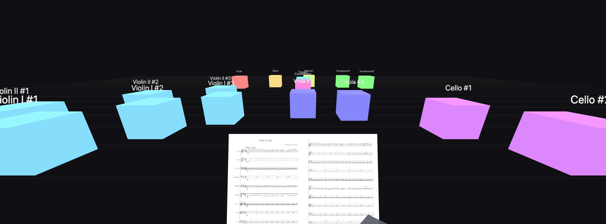

# MuseScoreVR

Listen to a MuseScore score from inside the orchestra, in virtual reality.

Pick a piece (`.mscz`), seat the musicians on a plan, and hear the orchestra in spatial audio in the headset:
from the conductor's podium, or from any musician's chair.



<sub>Beethoven's Ode to Joy (public domain), symphonic seating, seen from the podium.</sub>

- **Sound**: the real MuseSounds, rendered by MuseScore, one track per part, spatialized (HRTF) with
  instrument radiation, decorrelated sections and room reverb.
- **MuseScore plugin**: seating presets, number of musicians per part, drag-and-drop placement, sound settings,
  sending to the headset.
- **Player** (headset, tested on Meta Quest 3): playback only. Listen, pause, change seats.
  The musicians (cubes colored by family) light up when they play.
- **Music stands**: every musician has their part on their stand, the conductor has the full score.
  Pages turn by themselves, and notes light up while they sound.

The interface is in French for now.

## Installation

- [MuseScore 4](https://musescore.org) (tested with 4.7) with the MuseSounds installed through Muse Hub
- Download the zip for your system from the [releases](https://github.com/gouz/MuseScoreVR/releases)
  (`MuseScoreVR-<version>-macos.zip`, `-windows.zip` or `-linux.zip`) and unzip it into MuseScore's plugins folder,
  which gives `Documents/MuseScore4/Plugins/MuseScoreVR`
- macOS: the server is not notarized by Apple; after unzipping, allow the folder once in the Terminal:
  `xattr -dr com.apple.quarantine ~/Documents/MuseScore4/Plugins/MuseScoreVR`
- In MuseScore: Home › Plugins, enable **MuseScoreVR**
- On the Quest: nothing to install, it is a web page (Quest browser)

The plugin ships its own small server (`plugin/bin/`, one executable per system). It starts it when it opens,
and the server stops with MuseScore. Nothing else to install: no Bun, no ffmpeg.
On first launch, the system firewall may ask to allow `musescorevr` on the local network: accept,
that is how the Quest receives the piece.

## Usage

1. Open a score in MuseScore, then **Plugins › MuseScoreVR**.
   The plugin saves the score, then renders it. The score must have been saved with MuseScore 4 (open a MuseScore 3
   score and save it first). For the music stands, generate the parts ("Parts" button) before saving.
   Instruments hidden in MuseScore are left out.
2. The first render takes ~30 s per part (MuseScore renders each part with the MuseSounds). It is kept:
   reopening the same score is instant.
3. **On the Quest**: open the address shown at the bottom of the plugin window (`https://<pc-ip>:8443/`),
   accept the certificate warning, and leave the page open.
4. In the plugin: choose a seating (score order, symphony orchestra, concert band, big band), set the number of
   musicians, move them if needed, then **"Envoyer au casque"** (send to the headset).
   The Quest loads the piece by itself, even while already in VR. The play / pause / stop buttons control playback
   in the headset.
5. In the headset, "Enter VR". With your hands (or the controllers):
   point at a musician and pinch to take their seat, at the podium to go back to the conductor.
   Touch the panel on your right with a finger: play / pause, stop, ±10 s, previous / next seat,
   volume, time bar, ✕ to leave VR.

Keep the plugin window open while listening: closing it stops the server (the piece already received keeps playing
in the headset, but the remote no longer responds).

## Development

[Bun](https://bun.sh) ≥ 1.3 builds the plugin and runs the tests.

```sh
bun install
bun run plugin --here   # builds the server for this system only, copies the headset page into plugin/
bun run plugin          # for macOS (universal binary), Windows and Linux
bun run plugin --release 1.2.0   # + dist/MuseScoreVR-1.2.0-<os>.zip, like a release
# while developing, a real folder whose contents are linked (MuseScore doesn't follow a linked folder):
mkdir -p ~/Documents/MuseScore4/Plugins/MuseScoreVR
for f in MuseScoreVR.qml layout.mjs logo.png bin web; do ln -sfn "$PWD/plugin/$f" ~/Documents/MuseScore4/Plugins/MuseScoreVR/; done
bun run serve           # the server from the sources (the plugin uses it if it is already running)
bun run stems score.mscz project.zip   # rendering only, from the command line
```

After changing `MuseScoreVR.qml`, quit and restart MuseScore: it keeps a plugin in memory once loaded.

### Publishing a version

Push a `v<version>` tag (`git tag v1.2.0 && git push origin v1.2.0`): the CI (`.github/workflows/release.yml`)
runs the tests, builds the plugin for macOS, Windows and Linux, and creates the GitHub release with one zip per system.

## Project format

An **uncompressed** `.zip`, which the browser reads piece by piece without loading it whole:

```
project.json        title, parts (family, rank, number of musicians), seats, settings
<part>/<n>.flac     10 s mono slices, without reverb (silent slices are left out)
room.wav|flac       optional: impulse response of a real hall
scores/full/        full score: SVG pages (<n>.svg) + sheet.json (page turns, time of every note)
scores/<part>/      the part, same format
```

Without `room.*`, a synthetic reverb is used. Impulse responses of real halls can be found
in the OpenAIR library, for example; each has its own license, check it before sharing a project.

Instrument families and their order come from the score's `<Order>` block.
During playback, only the slices of the next ~12 seconds are decoded: memory stays flat
whatever the length of the piece.

## Structure

```
plugin/MuseScoreVR.qml  the plugin: UI inside MuseScore, starts the server and talks to it
plugin/logo.svg       the plugin's logo (logo.png: thumbnail in MuseScore's plugin list)
tools/serve.js        server: rendering, headset page over HTTPS on the Wi-Fi, sends pieces and commands
tools/stems.js        .mscz → project (MuseScore command-line rendering, one part at a time, soloed)
tools/flac.js         reads MuseScore's WAV, encodes FLAC (no ffmpeg)
tools/sheet.js        SVG pages + MuseScore timing positions (.spos) → page turns and time of every note
tools/build-plugin.js assembles plugin/: server compiled per system, headset page; release zips
proto/index.html      VR player (headset)
proto/engine.js       project opening, streamed spatial audio, levels, volume
proto/stands.js       music stands: score open like a book, notes lit while they sound
proto/layout.js       seating presets, families as blocks, instrument radiation (also used by the plugin)
proto/zip.js          zip: uncompressed writing, uncompressed and deflate reading (.mscz)
```

## Tests

```sh
bun test
```

## MuseSounds and rights

This repository contains no sound. The MuseSounds are under their own license: the projects you
generate contain audio rendered with them. Don't publish them without checking what their license
allows (and the rights of the score itself).

## License

[GPL-3.0](LICENSE)
